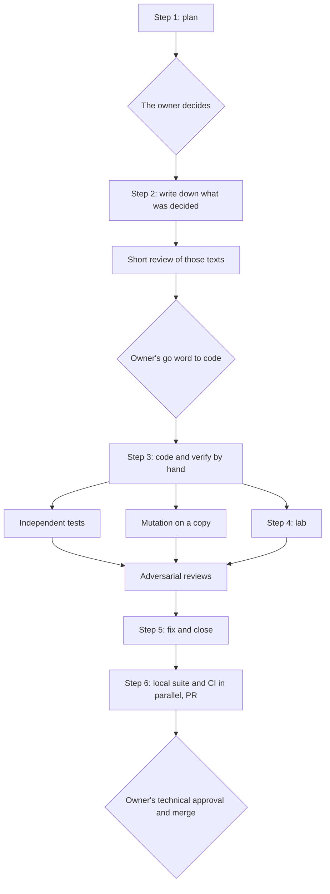
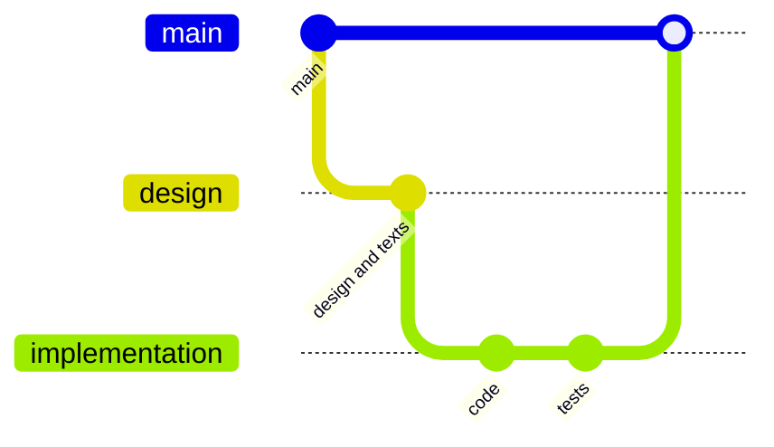

# Complete guide

How each part of the methodology works and why it is built that way. To set it up in a project, see the [adoption guide](adoption.md). For the detail the agent reads, see the skill's references (`plugins/metodologia-agentes/skills/agent-methodology/references/`).

## Contents

1. [Who it is for](#1-who-it-is-for)
2. [The roles](#2-the-roles)
3. [A session from start to end](#3-a-session-from-start-to-end)
4. [Decisions](#4-decisions)
5. [Memory in the repository](#5-memory-in-the-repository)
6. [The cycle of a module](#6-the-cycle-of-a-module)
7. [Tests, mutation and reviews](#7-tests-mutation-and-reviews)
8. [Two agents in the same repository](#8-two-agents-in-the-same-repository)
9. [Repository, PRs and CI](#9-repository-prs-and-ci)
10. [Context and usage](#10-context-and-usage)
11. [What is configured](#11-what-is-configured)
12. [Small projects and large teams](#12-small-projects-and-large-teams)
13. [The mistakes it prevents](#13-the-mistakes-it-prevents)
14. [Limits](#14-limits)

## 1. Who it is for

For projects where:

- one or two code agents do most of the work of planning, coding and reviewing;
- one person answers for the technical side and wants to decide, not just approve at the end;
- the work lasts longer than one chat: weeks, several computers, sometimes two agents at once;
- the product has to meet a technical source (a standard, a specification, an API contract, a regulation), or at least has business rules that cannot be wrong.

When it is not worth it: a one-afternoon script, a prototype that will be thrown away or a project with nobody to decide. There the process weighs more than what it protects (see [section 12](#12-small-projects-and-large-teams)).

## 2. The roles

| Role | Who | What it does | What it does not do |
|---|---|---|---|
| Technical owner | One person | Decides the technical side, including how results and warnings are presented to the user; approves the technical PRs; does the merge | Write the approval line for someone else |
| Area owner | Another person, if there is one | Decides their area (for example, the interface) | Decide technical matters outside their area |
| Coordinating agent | The main chat, with the most capable model | Plans, designs, proposes decisions, coordinates executors, judges findings | Decide for the owner |
| Executors | Subagents, with a cheaper model | Follow exact contracts: reading, coding bounded tasks, tests, mutation | Decide anything that calls for judgment |
| Second agent | For example Codex, in its own worktree | The tasks the owner assigns to it | Touch the other's folder, branches or PRs |

Who decides what is written in the project's `CLAUDE.md`. If it is not written down, the agent asks.

## 3. A session from start to end

1. **Start.** The agent reads `CLAUDE.md`, `AGENTS.md` if there is another agent, and the memory folder of `main` and of its branch. It runs `git fetch --prune`, `git worktree list` and `git status`. That way it knows what was decided, which branch each agent is on and what was left uncommitted.
2. **Work.** It follows the cycle of the module it is on ([section 6](#6-the-cycle-of-a-module)). Each answer from the owner is copied to the log as soon as it arrives.
3. **Close.** Because of the usage limit, a full context or because the task is finished: memory up to date, changelog, commit, push and a prompt for the next chat, in a code block, with where everything stands.

The close is what lets the next chat, on another computer or with another agent, continue without asking what was already known.

## 4. Decisions

### How they are asked

In a numbered list, each with its lettered options and the recommended one first and in bold. An example of the form, for any project:

```
1. How are amounts stored in the database?
   - **a) In cents, as integers.** Avoids rounding errors in sums; requires converting when displaying.
   - b) As fixed-precision decimals. More readable; depends on all the code using the same type.
2. What happens if a payment arrives duplicated?
   - **a) The second one is rejected with an error that says which was the first.**
   - b) It is accepted and flagged for manual review.

I take this as decided, tell me if not: amounts are displayed with two decimals, as the requirements document says.

Our interpretation, listed separately: "duplicate" is the same payment identifier from the provider, even if the amount differs.
```

The owner answers "1a, 2b". No paragraphs to reread, no ambiguity about what was chosen.

Why this way:

- **The recommended one first** because the agent has the technical context fresh and the owner has no reason to rebuild it. But the decision is still the owner's.
- **"I take this as decided"** because asking about what is implicit spends the owner's attention on what does not need it. It is still said, so the owner can correct it.
- **Interpretations listed separately** because they are the point where the agent fills a gap in the source, and the owner has to see them one by one.
- **Right away:** decisions are passed on as soon as they exist, without waiting for informational sweeps, so the owner is not the bottleneck.

### How they are recorded

Each answer goes to the verbatim log as soon as it arrives: what was asked, the owner's words as they are and what the owner did not say. Weeks later, when someone asks why something is the way it is, the quote settles the doubt without interpretation.

### Against the technical source

If a decision, even the owner's, goes against the technical source, the agent does not apply it silently. It cites the source, explains what would happen and proposes the option that complies. It also does not leave the product stricter than the source without saying so.

## 5. Memory in the repository

```
<repo>/
├── CLAUDE.md                     lasting team rules (loaded in every session)
├── AGENTS.md                     for the other agent: points to CLAUDE.md and to the memory
├── CHANGELOG.md                  every change, however small
└── MEMORY/
    ├── README.md
    ├── team_log.md               per machine and date: commits, pushes, PRs, branches, uncommitted work
    ├── machines.md               how each computer is set up
    └── owner_answers.md          the owner's answers, verbatim
```

An agent's local memory stays on one computer and the other agent does not see it. The repository travels with Git. So:

- rules that always apply go in `CLAUDE.md`, never only in local memory;
- what happened (commits, PRs, answers) goes in `MEMORY/`, on the branch being worked on;
- what happens after the last commit of a branch (the push, the PR, the merge) is noted on the next branch;
- if a memory plugin conflicts with the repo, the repo wins.

With several people or several computers, every commit made outside the main computer carries a `Machine: <machine-name>` line, added by a local Git hook. That way `git log --grep "Machine: <machine-name>"` finds what was done from there.

## 6. The cycle of a module



1. **Plan.** Read the source in its original, not from memory. Give the owner what the source says, what the product does today, which cases it applies to, how much the decision weighs and the decisions in a list, with the interpretations listed separately.
2. **Write down what was decided** in the documents that are the source of truth, with the owner's words. A short review of those texts. The commit, when the owner asks for it.
3. **Code**, only with the owner's go word. The agent verifies by hand with the numbers from the documents and one full case through the real chain, and launches independent tests, mutation and the lab page.
4. **Lab**: a local page that calls the real code, so the owner can see cases without waiting for the reviewers.
5. **Fix and close** what was confirmed. If a test contradicts a fix, the written decision wins, and the technical source wins over everything.
6. **Push:** integrate `main`, start the local suite and open the PR at the same time, so the local suite and the CI run together.

The order matters: planning first avoids code for a rule that was going to change, and writing down what was decided first leaves something to test against.

## 7. Tests, mutation and reviews

They are three different tools:

| Tool | What it answers | Key rule |
|---|---|---|
| Independent tests | Does the code give what it should? | Expected values by hand, from the source; never copied from the code |
| Mutation | Do the tests detect errors? | Always on a copy of the commit; "detected" is a failed assertion, not an exception |
| Adversarial reviews | What did nobody think to test? | Different lenses and one verifier per finding that tries to refute it |

A test that copies the code's result only checks that the code gives what it gives: it always passes, also when it is wrong. That is why the test agents each write in their own file, with their own oracle, without seeing the other agents' tests.

Reviews are requested with a prior question: who reviews (the main agent, the other agent or both). A finding from another agent is just one more finding and goes through the verifier. A review of an agent's code done by the same agent is not independent; if the owner chooses it for cost, it is noted.

## 8. Two agents in the same repository

Each agent in its own folder: one in the main folder, the other in a Git worktree. Each task belongs to a single agent, on its own branch created from `main`:

```bash
git fetch --prune
git switch --no-track -c <branch> origin/main
git push -u origin <branch>
```

When one designs and the other codes, the coder's branch is created from the designer's:



The rules that prevent the most problems:

- **Agents do not talk to each other directly:** the owner passes the messages, which each agent leaves ready in a code block.
- **Neither assumes what the other did:** it verifies in Git and in the memory.
- **Shared files** (changelog, memory, documents) are integrated with merge, never with rebase, keeping both sides.
- **Models by function:** the most capable one for planning and judging; a cheaper one for executing closed contracts. Executors do not decide.

## 9. Repository, PRs and CI

- **Protected `main`:** only through a PR, with the required checks green and with merge, not squash.
- **The owner's technical review** for the files in a versioned list. The approval line in the PR is written only by the owner, with the date and the last commit. That line is a record and authenticates nobody; the verifiable approval is the required `CODEOWNERS` review in the protection of `main`.
- **Changelog for everything.** A commit without its changelog entry is not made.
- **Local suite and CI in parallel.** With the PR open, the result of the local suite goes in the PR description: editing it does not run the suite again (its workflow does not listen to `edited`), a commit does. The approval line check, on the other hand, listens to `edited`, to be re-evaluated when the owner checks the line.
- **Small fixes go in the PR in progress**, not in a separate one: each PR costs CI minutes and a review.
- **The routine after the merge of one's own PR:** in the folder that owns `main`, update local `main`, delete the branch, check the CI on `main`, rebuild the published environment and note it. The worktree agent does not switch to `main`: it creates its next branch from `origin/main`. After a merge by the other agent, whoever has a task in progress keeps its branch and merges `origin/main` into it.

## 10. Context and usage

A chat's context and an account's weekly usage run out. The methodology takes care of them like this:

- the results of many agents are summarized with a script, not read in full;
- agent reports are short (under 25 lines) and structured;
- in tasks that are not coding, the agent works mostly on its own and asks permission before launching more than 6 agents;
- near the usage limit, the agent warns and proposes how to continue, with everything committed.

## 11. What is configured

All of this is agreed with the owner and written in the project's `CLAUDE.md`:

| What | Example value | Why it matters |
|---|---|---|
| The word that authorizes coding | "go" | Separates planning from coding without ambiguity |
| Language and form of address | Spanish, informal (tú) | A person reads the messages every day |
| Who reviews by default | Ask each time | Reviews spend usage; the owner chooses who |
| Files that require technical review | A list in `.github/` | The PR check reads it |
| Agents and models | One to coordinate, another to execute | Cost and quality |
| CI budget | Minutes per month | Defines how many PRs and how many pushes are appropriate |
| Tool attribution in PRs | None | Team preference |

## 12. Small projects and large teams

**Small project, one person:** the person is the owner. They can keep the decision list, the memory in the repo, the changelog and the plan-then-code cycle. What can be cut without losing the essentials: the second agent, mutation in every module and reviews with several lenses. What should not be cut: hand-written expected values in the tests and the memory in the repo.

**Large team:** each area with its owner, written in `CLAUDE.md`. The list of files that require technical review becomes the map of who approves what. The log per machine becomes per person and machine.

## 13. The mistakes it prevents

| What happens without the methodology | Which rule prevents it |
|---|---|
| The agent makes a technical decision silently | The owner decides; interpretations are listed separately |
| A new chat repeats a discussion that was already closed | The verbatim log in the repo |
| Tests pass even though the code is wrong | Expected values by hand and mutation |
| Two agents edit the same file at once | Separate folders and one task per agent |
| A rebase wipes out the other agent's work | Merge, never rebase, keeping both sides |
| The CI restarts because of a commit that only records results | The result goes in the PR description |
| The chat runs out of context halfway | Close with memory up to date and a prompt for the next one |

## 14. Limits

- The skill instructs; it does not enforce. What actually enforces the rules is the project's `CLAUDE.md`, the protection of `main`, the PR checks and the team's discipline.
- It depends on the model following the instructions. That is why the important rules also go in `CLAUDE.md`, which is loaded in every session.
- It brings no hooks, commands or servers.
- It activates from its description. If it does not activate, it can be requested explicitly ("let's work with the methodology").
