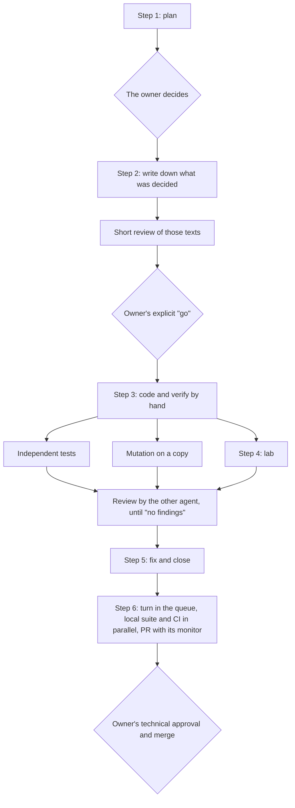
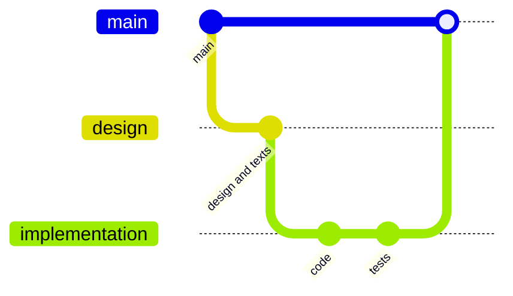

# Complete guide

How each part of the methodology works and why it is built that way. To set it up in a project, see the [adoption guide](adoption.md). For the detail the agent reads, see the skill's references (`plugins/metodologia-agentes/skills/agent-methodology/references/`).

## Contents

1. [Who it is for](#1-who-it-is-for)
2. [The roles](#2-the-roles)
3. [A session from start to end](#3-a-session-from-start-to-end)
4. [Decisions](#4-decisions)
5. [Memory in the repository](#5-memory-in-the-repository)
6. [The cycle of a module](#6-the-cycle-of-a-module)
7. [Tests, mutation and reviews](#7-tests-mutation-and-reviews)
8. [Two agents in the same repository](#8-two-agents-in-the-same-repository)
9. [The map, the hub and orchestration](#9-the-map-the-hub-and-orchestration)
10. [Repository, PRs and CI](#10-repository-prs-and-ci)
11. [Context and usage](#11-context-and-usage)
12. [What is configured](#12-what-is-configured)
13. [Small projects and large teams](#13-small-projects-and-large-teams)
14. [The mistakes it prevents](#14-the-mistakes-it-prevents)
15. [Limits](#15-limits)

## 1. Who it is for

For projects where:

- one or two code agents do most of the work of planning, coding and reviewing;
- one person answers for the technical side and wants to decide, not just approve at the end;
- the work lasts longer than one chat: weeks, several computers, sometimes two agents at once;
- the product has to meet a technical source (a standard, a specification, an API contract, a regulation), or at least has business rules that cannot be wrong.

When it is not worth it: a one-afternoon script, a prototype that will be thrown away or a project with nobody to decide. There the process weighs more than what it protects (see [section 13](#13-small-projects-and-large-teams)).

## 2. The roles

| Role | Who | What it does | What it does not do |
|---|---|---|---|
| Technical owner | One person | Decides the technical side, including how results and warnings are presented to the user; approves the technical PRs; does the merge | Write the approval line for someone else |
| Area owner | Another person, if there is one | Decides their area (for example, the interface) | Decide technical matters outside their area |
| Coordinating agent (the orchestrator) | The main chat; can be a cheap model | Plans, proposes decisions, coordinates the others and judges at the gates; makes the commits | Decide for the owner; write code; review its own work |
| Thinking workers | Subagents with the strong model and high effort | Design, refute, synthesize and verify by hand | Do mechanical work |
| Executors | Subagents, with a cheaper model | Follow exact contracts: reading, coding bounded tasks, tests, mutation | Decide anything that calls for judgment |
| Second agent | For example Codex, in its own worktree | The tasks the owner assigns to it; reviews the first agent's work | Touch the other's folder, branches or PRs |
| Hub | One more chat, when there are several chats at once | Keeps the board, gathers the decisions into a single list and passes on the owner's verbatim words | Code, review, decide, make commits |

Who decides what is written in the project's `CLAUDE.md`. If it is not written down, the agent asks.

## 3. A session from start to end

1. **Start.** The agent reads `CLAUDE.md`, `AGENTS.md` whenever Codex is used, the memory folder of `main` and of its branch, and the plan map, if there is one, to know which block falls to it. It runs `git fetch --prune`, `git worktree list` and `git status`. If it is the first chat of the day on that machine, it checks the versions and the health of the environment. That way it knows what was decided, which branch each agent is on and what was left uncommitted.
2. **Work.** It follows the cycle of the module it is on ([section 6](#6-the-cycle-of-a-module)). Each answer from the owner is copied to the verbatim record as soon as it arrives. Each thing done is ticked in the map in the same commit.
3. **Close.** Because of the usage limit, a full context, a threshold, or because the task or the block is finished: memory and map up to date, changelog, commit and push if the owner asked for it or the project agreed on it in `CLAUDE.md`, and a prompt for the next chat, in a code block, with the model and effort it is opened with and where everything stands. If there is a hub, the closing report with its schema.

The close is what lets the next chat, on another computer or with another agent, continue without asking what was already known.

## 4. Decisions

### How they are asked

In a numbered list, each with its lettered options and the recommended one first and in bold. An example of the form, for any project:

```
1. How are amounts stored in the database?
   - **a) In cents, as integers.** Avoids rounding errors in sums; requires converting when displaying.
   - b) As fixed-precision decimals. More readable; depends on all the code using the same type.
2. What happens if a payment arrives duplicated?
   - **a) The second one is rejected with an error that says which was the first.**
   - b) It is accepted and flagged for manual review.

I take it as decided, tell me if not: amounts are displayed with two decimals, as the requirements document says.

Our interpretation, listed separately: "duplicate" is the same payment identifier from the provider, even if the amount differs.
```

The owner answers "1a, 2b". No paragraphs to reread, no ambiguity about what was chosen.

Why this way:

- **The recommended one first** because the agent has the technical context fresh and the owner has no reason to rebuild it. But the decision is still the owner's.
- **"I take it as decided"** because asking about what is implicit spends the owner's attention on what does not need it. It is still said, so the owner can correct it.
- **Interpretations listed separately** because they are the point where the agent fills a gap in the source, and the owner has to see them one by one.
- **Right away:** decisions are passed on as soon as they exist, without waiting for informational sweeps, so the owner is not the bottleneck.

### How they are recorded

Each answer goes to the verbatim record as soon as it arrives: what was asked, the owner's words as they are and what the owner did not say. Weeks later, when someone asks why something is the way it is, the quote settles the doubt without interpretation.

### Against the technical source

If a decision, even the owner's, goes against the technical source, the agent does not apply it silently. It cites the source, explains what would happen and proposes the option that complies. It also does not leave the product stricter than the source without saying so.

## 5. Memory in the repository

```
<repo>/
├── CLAUDE.md                     shared rules (Claude loads them; AGENTS.md tells Codex to read them)
├── AGENTS.md                     for Codex, even alone: tells it to read CLAUDE.md and memory
├── CHANGELOG.md                  every change, however small
└── MEMORY/
    ├── README.md
    ├── team_log.md               per machine and date: commits, pushes, PRs, branches, uncommitted work
    ├── machines.md               how each computer is set up
    └── owner_answers.md          the owner's answers, verbatim
```

An agent's local memory stays on one computer and the other agent does not see it. The repository travels with Git. So:

- rules that always apply go in `CLAUDE.md`, never only in local memory;
- what happened (commits, PRs, answers) goes in `MEMORY/`, on the branch being worked on;
- what happens after the last commit of a branch (the push, the PR, the merge) is noted on the next branch;
- if a memory plugin conflicts with the repo, the repo wins.

With several people or several computers, every commit made outside the main computer carries a `Machine: <name>` line, added by a local Git hook. The search for what was done from there, without putting the name in the command, is in the skill's `references/templates.md`, "Machine hook".

## 6. The cycle of a module



1. **Plan.** Read the source in its original, not from memory. Give the owner what the source says, what the product does today, which cases it applies to, how much the decision weighs and the decisions in a list, with the interpretations listed separately.
2. **Write down what was decided** in the documents that are the source of truth, with the owner's words. A short review of those texts, by the other agent. The commit, when the owner asks for it.
3. **Code**, only with the owner's explicit "go" for that task, on any front; a written plan is not coding. The agent verifies by hand with the numbers from the documents and one full case through the real chain, and launches independent tests, mutation and the lab page. With an orchestrator and executors ([section 9](#9-the-map-the-hub-and-orchestration)), the main chat does not write the code.
4. **Lab**: a local page that calls the real code, so the owner can see cases without waiting for the reviewers.
5. **Fix and close** what was confirmed. If a test contradicts a fix, the written decision wins, and the technical source wins over everything. The review goes in rounds until "no findings".
6. **Push:** integrate `main`, wait for the turn in the merge queue, start the local suite and open the PR at the same time, with the PR's monitor on, so the local suite and the CI run together. With the CI green, ask for the approval line once.

The order matters: planning first avoids code for a rule that was going to change, and writing down what was decided first leaves something to test against.

## 7. Tests, mutation and reviews

They are three different tools:

| Tool | What it answers | Key rule |
|---|---|---|
| Independent tests | Does the code give what it should? | Expected values by hand, from the source; never copied from the code |
| Mutation | Do the tests detect errors? | Always on a copy of the commit; "detected" is a failed assertion, not an exception |
| Adversarial reviews | What did nobody think to test? | Different lenses and one verifier per finding that tries to refute it |

A test that copies the code's result only checks that the code gives what it gives: it always passes, also when it is wrong. That is why the test agents each write in their own file, with their own oracle, without seeing the other agents' tests.

Nobody reviews their own work: what one agent did is reviewed by the other, in a new read-only chat that verifies each finding itself, and that option is not offered to the owner. The mechanical validators, the ones that check with real commands and counts, keep running but do not count as a review. The review goes in rounds: finding, fix, commit and a re-check on the exact diff, until "no findings"; only then is the PR opened. With a single agent in the project, a new read-only chat of that agent reviews and it is noted that it is not independent.

## 8. Two agents in the same repository

Each agent in its own folder: one in the main folder, the other in a Git worktree. Each task belongs to a single agent, on its own branch created from `main`:

```bash
git fetch --prune
git switch --no-track -c <branch> origin/main
git push -u origin <branch>
```

When one designs and the other codes, the coder's branch is created from the designer's:



The rules that prevent the most problems:

- **Agents do not talk to each other directly:** the owner passes the messages, which each agent leaves ready in a code block. With a hub, the chats of the same agent talk through the hub; those of the other agent still go through the owner.
- **Every prompt for a new chat states model and effort**, and is passed to the owner as soon as it is ready, without being asked.
- **Neither assumes what the other did:** it verifies in Git and in the memory.
- **Shared files** (changelog, memory, map, documents) are integrated with merge, never with rebase, keeping both sides.
- **Models by function:** a cheap orchestrator that coordinates and judges; the strong model, with high effort, for designing, refuting and verifying; a cheaper one for executing closed contracts. Executors do not decide ([section 9](#9-the-map-the-hub-and-orchestration)).

## 9. The map, the hub and orchestration

Three pieces for when the work stops fitting in one chat: several fronts at once, several chats and workflows with many agents.

### The plan map

A file in the repository with the plan by blocks: what each block is, its status, what it depends on, what runs in parallel and what in series, and what the project still lacks that is not in the map. Each step is a checkbox, and **each thing done is ticked in the same commit that does it**, with who, the date and the commit or the evidence; the owner's steps are ticked by the agent that receives the answer, with the owner's words. Nothing is deleted: what stops applying is struck through and the reason is given. A script generates the drawing of the map from the file and a test in the suite checks that they match. Every chat reads it at the start, to know which block it is on and what falls to it.

### The hub

When there are several working chats at once, the owner cannot keep up with all of them without decisions crossing. The hub is one more chat, the orchestrator of orchestrators and the owner's only contact with the working chats: it keeps the board (which chat does what, on which branch and in what state), gathers everything the owner has to decide into a single list numbered consecutively, passes the owner's answers to the chats in the owner's verbatim words, writes the prompts for new chats (always with model and effort) and watches the merge queue and that two branches do not touch the same files. It does not code, review or make commits. The chats report to it only at milestones, with a fixed schema of fewer than 15 lines, without acknowledgements. If there are chats of both agents and the other's client cannot write to the hub (in Codex, its automatic review blocks those sends), there is a mirror hub in that client that only creates the chats with the prompts it receives, without running them; those chats do not report to any hub: they leave their report and the owner pastes the result.

### Orchestrator, thinking workers and executors

Once the "go" is given, the main chat orchestrates and does not do the work: it coordinates and judges at the gates between phases, reads summaries with a schema and not transcripts, and makes the commits. It can be a cheap model. The thinking workers (design, refutation, verification by hand) use the strong model with high effort. The executors use a cheaper model, receive exact contracts, have two attempts and decide nothing. Each phase is a workflow with a common script: documents; design with a designer and a refuter; execution with independent tests and mutation; verification by hand and validators with real commands (which do not count as a review); review by the other agent; close with the suite in parallel with the PR. The phases chain on their own and stop before the review only for something against the technical source, a discrepancy that the written decisions do not close or an executor that does not close in two attempts.

### Thresholds and economy

`CLAUDE.md` sets a warning threshold and a closing threshold for the context of the chat that orchestrates, for the weekly usage of the expensive model and for the total weekly usage. When approaching one, the agent says so; on reaching it, it closes everything without deleting anything and, depending on the case, passes a prompt to continue in another chat or says what is missing and how much it would cost, and the owner decides. The cost of a chat is its context times its turns: that is why one chat per block, no acknowledgements or step reports and verification only at milestones.

## 10. Repository, PRs and CI

- **Protected `main`:** only through a PR, with the required checks green and with merge, not squash.
- **The owner's technical review** for the files in a versioned list. The approval line in the PR is written only by the owner, with the date and the last commit; the agent asks for it once, with the CI green and no pending commits. That line is a record and authenticates nobody; the verifiable approval is the required `CODEOWNERS` review in the protection of `main`.
- **Every PR carries the client's PR monitor** (Auto-fix, in Claude Code), turned on by the session that opens it: it warns of CI failures, conflicts and comments, without polling. If the client has no monitor, that is said and the CI is checked when needed.
- **Merge queue:** only one PR in review at a time. The next is opened when the previous is merged and `main` integrated; whoever is ready announces it with its HEAD and waits for its turn.
- **Changelog for everything.** A commit without its changelog entry is not made.
- **Local suite and CI in parallel.** With the PR open, the result of the local suite goes in the PR description: editing it does not run the suite again (its workflow does not listen to `edited`), a commit does. The approval line check, on the other hand, listens to `edited`, to be re-evaluated when the owner checks the line.
- **Small fixes go in the PR in progress**, not in a separate one: each PR costs CI minutes and a review.
- **The routine after the merge of one's own PR:** in the folder that owns `main`, update local `main`, delete the branch, check the CI on `main`, rebuild the published environment and note it. The worktree agent does not switch to `main`: it creates its next branch from `origin/main`. After a merge by the other agent, whoever has a task in progress keeps its branch and merges `origin/main` into it.

## 11. Context and usage

A chat's context and an account's weekly usage run out. The methodology takes care of them like this:

- the cost of a chat is its context times its turns: one chat per block, no acknowledgements or step reports, a turn only when there is a milestone or a decision;
- the results of many agents are summarized with a script, not read in full; the orchestrator does not read transcripts;
- agent reports are short (under 25 lines) and with a schema; those of a chat to the hub, under 15;
- in tasks that are not coding, the agent works mostly on its own and asks permission before launching more than 6 agents;
- warning and closing thresholds, written in `CLAUDE.md`, for the context and the weekly usage ([section 9](#9-the-map-the-hub-and-orchestration)); near the limit, the agent warns and proposes how to continue, with everything committed if the owner asked for it or the project agreed on it in `CLAUDE.md`.

## 12. What is configured

All of this is agreed with the owner and written in the project's `CLAUDE.md`:

| What | Example value | Why it matters |
|---|---|---|
| The word that authorizes coding | "go", explicit and per task | Separates planning from coding without ambiguity, on every front |
| Language and form of address | Spanish, informal (tú) | A person reads the messages every day |
| Who reviews each agent's work | One agent's work is reviewed by the other, read-only | Nobody reviews their own work; the owner chooses the rest |
| Files that require technical review | A list in `.github/` | The PR check reads it |
| Agents and models | A cheap orchestrator, thinking workers with the strong model, cheaper executors | Cost and quality |
| Thresholds | Context, weekly usage of the expensive model and total weekly usage: warning and closing | Keep a chat from stopping halfway |
| Hub | Yes, when there are several chats; who opens the new chats; report schema | A single contact for the owner |
| PR monitor (Auto-fix in Claude Code) | Whenever the client has it, by the session that opens the PR | Warns without polling |
| Merge queue | Only one PR in review; the turn is announced by the hub or the owner | PRs do not cross |
| CI budget | Minutes per month | Defines how many PRs and how many pushes are appropriate |
| Tool attribution in PRs | None | Team preference |

## 13. Small projects and large teams

**Small project, one person:** the person is the owner. They can keep the decision list, the memory in the repo, the changelog and the plan-then-code cycle. What can be cut without losing the essentials: the second agent, mutation in every module, reviews with several lenses, the map and the hub. What should not be cut: expected values by hand in the tests, the memory in the repo and that whoever reviews is not the chat that did the work.

**Large team:** each area with its owner, written in `CLAUDE.md`. The list of files that require technical review becomes the map of who approves what. The team log per machine becomes per person and machine. With several chats at once, the hub and the merge queue ([section 9](#9-the-map-the-hub-and-orchestration)).

## 14. The mistakes it prevents

| What happens without the methodology | Which rule prevents it |
|---|---|
| The agent makes a technical decision silently | The owner decides; interpretations are listed separately |
| A new chat repeats a discussion that was already closed | The verbatim record in the repo |
| Tests pass even though the code is wrong | Expected values by hand and mutation |
| Two agents edit the same file at once | Separate folders and one task per agent |
| A rebase wipes out the other agent's work | Merge, never rebase, keeping both sides |
| The CI restarts because of a commit that only records results | The result goes in the PR description |
| The chat runs out of context halfway | Close with memory up to date and a prompt for the next one; warning and closing thresholds |
| The agent reviews what it wrote itself and does not see its errors | Nobody reviews their own work |
| Someone codes before the owner authorizes it | Nobody codes without the explicit "go" |
| Four chats at once and the owner loses the thread | The hub: board, single list of decisions, verbatim words |
| Two PRs cross on the same files | The merge queue |
| Something is taken as done and was not | The plan map: each thing is ticked in the same commit, with evidence |
| A different version on one machine breaks what works on another | The daily check of versions and health |
| A long chat spends the usage on acknowledgements and step reports | One chat per block, turns only at milestones |

## 15. Limits

- The skill instructs; it does not enforce. What actually enforces the rules is the project's `CLAUDE.md`, the protection of `main`, the PR checks and the team's discipline.
- It depends on the model following the instructions. That is why the important rules also go in `CLAUDE.md`, which Claude Code loads in every session and which `AGENTS.md` instructs Codex to read.
- It brings no hooks, commands or servers.
- It activates from its description in the projects that adopted it, without guarantee; in Codex, see [codex.md](codex.md). If it does not activate, it can be requested explicitly ("let's work with the methodology").
