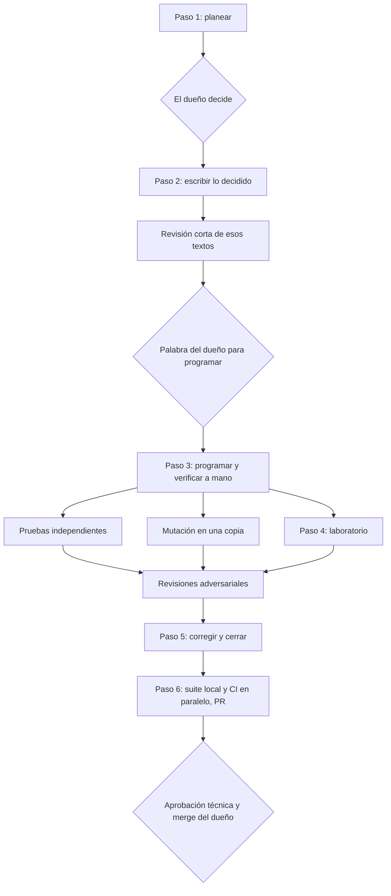
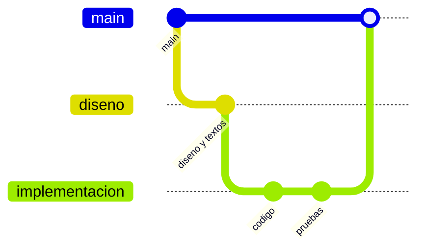

# Guía completa

Cómo funciona cada parte de la metodología y por qué está así. Para montarla en un proyecto, la [guía de adopción](adopcion.md). Para el detalle que lee el agente, las referencias de la skill (`plugins/metodologia-agentes/skills/metodologia-agentes/references/`).

## Contenido

1. [Para quién es](#1-para-quién-es)
2. [Los roles](#2-los-roles)
3. [Una sesión de principio a fin](#3-una-sesión-de-principio-a-fin)
4. [Las decisiones](#4-las-decisiones)
5. [La memoria en el repositorio](#5-la-memoria-en-el-repositorio)
6. [El ciclo de un módulo](#6-el-ciclo-de-un-módulo)
7. [Pruebas, mutación y revisiones](#7-pruebas-mutación-y-revisiones)
8. [Dos agentes en el mismo repositorio](#8-dos-agentes-en-el-mismo-repositorio)
9. [Repositorio, PR y CI](#9-repositorio-pr-y-ci)
10. [Contexto y uso](#10-contexto-y-uso)
11. [Qué se configura](#11-qué-se-configura)
12. [Proyectos chicos y equipos grandes](#12-proyectos-chicos-y-equipos-grandes)
13. [Los errores que evita](#13-los-errores-que-evita)
14. [Límites](#14-límites)

## 1. Para quién es

Para proyectos en los que:

- uno o dos agentes de código hacen la mayor parte del trabajo de planear, programar y revisar;
- hay una persona que responde por lo técnico y quiere decidir, no solo aprobar al final;
- el trabajo dura más de un chat: semanas, varios computadores, a veces dos agentes a la vez;
- el producto tiene que cumplir una fuente técnica (una norma, una especificación, un contrato de API, una regulación), o al menos tiene reglas de negocio que no se pueden equivocar.

Cuándo no conviene: un script de una tarde, un prototipo que se va a botar o un proyecto sin nadie que decida. Ahí el proceso pesa más de lo que protege (ver [sección 12](#12-proyectos-chicos-y-equipos-grandes)).

## 2. Los roles

| Rol | Quién | Qué hace | Qué no hace |
|---|---|---|---|
| Dueño técnico | Una persona | Decide lo técnico, incluido cómo se le presentan al usuario los resultados y los avisos; aprueba los PR técnicos; hace el merge | Escribir la línea de aprobación por otro |
| Dueño de un área | Otra persona, si la hay | Decide su área (por ejemplo, la interfaz) | Decidir lo técnico que no es de su área |
| Agente que coordina | El chat principal, con el modelo más capaz | Planea, diseña, propone decisiones, coordina ejecutores, juzga hallazgos | Decidir por el dueño |
| Ejecutores | Subagentes, con un modelo más económico | Siguen contratos exactos: leer, programar tareas acotadas, pruebas, mutación | Decidir algo que pida criterio |
| Segundo agente | Por ejemplo Codex, en su propio worktree | Las tareas que el dueño le asigna | Tocar la carpeta, las ramas o los PR del otro |

Quién decide qué se escribe en el `CLAUDE.md` del proyecto. Si no está escrito, el agente pregunta.

## 3. Una sesión de principio a fin

1. **Arranque.** El agente lee `CLAUDE.md`, `AGENTS.md` si hay otro agente, y la carpeta de memoria de `main` y de su rama. Corre `git fetch --prune`, `git worktree list` y `git status`. Así sabe qué se decidió, en qué rama está cada agente y qué quedó sin commit.
2. **Trabajo.** Sigue el ciclo del módulo en el que va ([sección 6](#6-el-ciclo-de-un-módulo)). Cada respuesta del dueño se copia al registro en el momento en que llega.
3. **Cierre.** Por límite de uso, por contexto lleno o porque se terminó la tarea: memoria al día, changelog, commit, push y un prompt para el chat siguiente, en un bloque de código, con dónde quedó todo.

El cierre es lo que permite que el chat siguiente, en otro computador o con otro agente, siga sin preguntar lo que ya se sabía.

## 4. Las decisiones

### Cómo se piden

En lista numerada, cada una con sus opciones con letra y la recomendada primero y en negrilla. Un ejemplo de forma, para un proyecto cualquiera:

```
1. ¿Cómo se guardan los montos en la base de datos?
   - **a) En centavos, como enteros.** Evita errores de redondeo en sumas; obliga a convertir al mostrar.
   - b) Como decimales de precisión fija. Más legibles; depende de que todo el código use el mismo tipo.
2. ¿Qué pasa si un pago llega duplicado?
   - **a) Se rechaza el segundo con un error que dice cuál fue el primero.**
   - b) Se acepta y se marca para revisión manual.

Lo doy por decidido, dime si no: los montos se muestran con dos decimales, como dice el documento de requisitos.

Interpretación nuestra, aparte: "duplicado" es el mismo identificador de pago del proveedor, aunque el monto difiera.
```

El dueño responde "1a, 2b". Sin párrafos que releer, sin ambigüedad sobre qué escogió.

Por qué así:

- **La recomendada primero** porque el agente tiene el contexto técnico fresco y el dueño no tiene por qué reconstruirlo. Pero la decisión sigue siendo del dueño.
- **"Lo doy por decidido"** porque preguntar lo implícito gasta la atención del dueño en lo que no la necesita. Se dice igual, para que pueda corregirlo.
- **Las interpretaciones aparte** porque son el punto donde el agente llena un vacío de la fuente, y el dueño tiene que verlas una por una.
- **De una:** las decisiones se pasan apenas existen, sin esperar barridos informativos, para que el dueño no sea el cuello de botella.

### Cómo se registran

Cada respuesta va al registro textual en el momento en que llega: lo que se preguntó, las palabras del dueño tal cual y lo que no dijo. Semanas después, cuando alguien pregunte por qué algo es así, la cita resuelve la duda sin interpretaciones.

### Contra la fuente técnica

Si una decisión, incluso del dueño, va en contra de la fuente técnica, el agente no la aplica en silencio. La cita, explica qué pasaría y propone la opción que cumple. Tampoco deja el producto más estricto que la fuente sin decirlo.

## 5. La memoria en el repositorio

```
<repo>/
├── CLAUDE.md                     reglas duraderas del equipo (se cargan en cada sesión)
├── AGENTS.md                     para el otro agente: apunta a CLAUDE.md y a la memoria
├── CHANGELOG.md                  todo cambio, por pequeño que sea
└── MEMORIA/
    ├── README.md
    ├── bitacora_equipos.md       por equipo y fecha: commits, push, PR, ramas, trabajo sin commit
    ├── entorno_equipos.md        cómo está montado cada computador
    └── registro_respuestas.md    las respuestas del dueño, textuales
```

La memoria local de un agente se queda en un computador y no la ve el otro agente. El repositorio viaja con Git. Por eso:

- las reglas que valen siempre van en `CLAUDE.md`, nunca solo en la memoria local;
- lo que pasó (commits, PR, respuestas) va en `MEMORIA/`, en la rama en la que se trabaja;
- lo que pasa después del último commit de una rama (el push, el PR, el merge) se anota en la rama siguiente;
- si un plugin de memoria choca con el repo, gana el repo.

Con varias personas o varios computadores, cada commit hecho fuera del computador principal lleva una línea `Equipo: <nombre>`, puesta por un gancho local de Git. Así `git log --grep "Equipo: <nombre>"` encuentra lo que se hizo desde ahí.

## 6. El ciclo de un módulo



1. **Planear.** Leer la fuente en su original, no de memoria. Pasarle al dueño lo que dice la fuente, lo que hace hoy el producto, a qué casos aplica, cuánto pesa la decisión y las decisiones en lista, con las interpretaciones aparte.
2. **Escribir lo decidido** en los documentos que son fuente de verdad, con las palabras del dueño. Una revisión corta de esos textos. El commit, cuando el dueño lo pida.
3. **Programar**, solo con la palabra del dueño. El agente verifica a mano con los números de los documentos y un caso completo por la cadena real, y lanza pruebas independientes, mutación y la página de laboratorio.
4. **Laboratorio**: una página local que llama al código real, para que el dueño vea casos sin esperar a los revisores.
5. **Corregir y cerrar** lo confirmado. Si una prueba contradice una corrección, gana la decisión escrita, y la fuente técnica gana sobre todo.
6. **Subir:** integrar `main`, arrancar la suite local y abrir el PR al mismo tiempo, para que la local y la CI corran juntas.

El orden importa: planear antes evita código para una regla que iba a cambiar, y escribir lo decidido antes deja algo contra qué probar.

## 7. Pruebas, mutación y revisiones

Son tres herramientas distintas:

| Herramienta | Qué responde | Regla clave |
|---|---|---|
| Pruebas independientes | ¿El código da lo que debe? | Valores esperados a mano, desde la fuente; nunca copiados del código |
| Mutación | ¿Las pruebas detectan errores? | Siempre en una copia del commit; "detectado" es una aserción fallida, no una excepción |
| Revisiones adversariales | ¿Qué no se le ocurrió a nadie probar? | Lentes distintos y un verificador por hallazgo que intenta refutarlo |

Una prueba que copia el resultado del código solo comprueba que el código da lo que da: pasa siempre, también cuando está mal. Por eso los agentes de pruebas escriben cada uno en su propio archivo, con su propio oráculo, sin ver las pruebas de los otros.

Las revisiones se piden con una pregunta previa: quién revisa (el agente principal, el otro agente o los dos). Un hallazgo de otro agente es un hallazgo más y pasa por el verificador. Una revisión del código de un agente hecha por el mismo agente no es independiente; si el dueño la escoge por costo, queda anotado.

## 8. Dos agentes en el mismo repositorio

Cada agente en su carpeta: uno en la carpeta principal, el otro en un worktree de Git. Cada tarea, de un solo agente, en su propia rama nacida de `main`:

```bash
git fetch --prune
git switch --no-track -c <rama> origin/main
git push -u origin <rama>
```

Cuando uno diseña y el otro programa, la rama del que programa nace de la del que diseñó:



Las reglas que más problemas evitan:

- **Los agentes no se hablan directo:** el dueño pasa los mensajes, que cada agente deja listos en un bloque de código.
- **Ninguno da por hecho lo que hizo el otro:** lo verifica en Git y en la memoria.
- **Los archivos compartidos** (changelog, memoria, documentos) se integran con merge, nunca con rebase, conservando los dos lados.
- **Modelos por función:** el más capaz para planear y juzgar; uno más económico para ejecutar contratos cerrados. Los ejecutores no deciden.

## 9. Repositorio, PR y CI

- **`main` protegida:** solo por PR, con los checks obligatorios en verde y con merge, no squash.
- **Revisión técnica del dueño** para los archivos de una lista versionada. La línea de aprobación en el PR la escribe solo el dueño, con la fecha y el último commit. Esa línea es un registro y no autentica a nadie; la aprobación verificable es la revisión obligatoria de `CODEOWNERS` en la protección de `main`.
- **Changelog para todo.** Un commit sin su entrada en el changelog no se hace.
- **Suite local y CI en paralelo.** Con el PR abierto, el resultado de la suite local va en la descripción del PR: editarla no vuelve a correr la suite (su workflow no escucha `edited`), un commit sí. El check de la línea de aprobación, en cambio, escucha `edited`, para reevaluarse cuando el dueño la marca.
- **Correcciones chiquitas en el PR en curso**, no en uno aparte: cada PR cuesta minutos de CI y una revisión.
- **La rutina después del merge del PR propio:** en la carpeta dueña de `main`, actualizar `main` local, borrar la rama, revisar la CI de `main`, reconstruir el entorno publicado y anotarlo. El agente del worktree no se cambia a `main`: crea su rama siguiente desde `origin/main`. Después de un merge ajeno, quien tenga una tarea en curso conserva su rama y une `origin/main` en ella.

## 10. Contexto y uso

El contexto de un chat y el uso semanal de una cuenta se acaban. La metodología los cuida así:

- los resultados de muchos agentes se resumen con un script, no se leen completos;
- los reportes de los agentes son cortos (menos de 25 líneas) y con esquema;
- en tareas que no son programar, el agente trabaja casi solo y pide permiso antes de lanzar más de 6 agentes;
- cerca del límite de uso, el agente avisa y propone cómo seguir, con todo en commit.

## 11. Qué se configura

Todo esto se acuerda con el dueño y se escribe en el `CLAUDE.md` del proyecto:

| Qué | Ejemplo de valor | Por qué importa |
|---|---|---|
| La palabra que autoriza programar | "programa" | Separa planear de programar sin ambigüedad |
| Idioma y trato | Español, de tú | Los mensajes los lee una persona todos los días |
| Quién revisa por defecto | Preguntar cada vez | Las revisiones gastan uso; el dueño escoge quién |
| Archivos que exigen revisión técnica | Una lista en `.github/` | El check del PR la lee |
| Agentes y modelos | Uno para coordinar, otro para ejecutar | Costo y calidad |
| Presupuesto de CI | Minutos al mes | Define cuántos PR y cuántos push convienen |
| Atribución de herramientas en los PR | Ninguna | Preferencia del equipo |

## 12. Proyectos chicos y equipos grandes

**Proyecto chico, una persona:** la persona es el dueño. Se puede quedar con la lista de decisiones, la memoria en el repo, el changelog y el ciclo planear-programar. Lo que se puede recortar sin perder lo esencial: el segundo agente, la mutación en cada módulo y las revisiones con varios lentes. Lo que no conviene recortar: los valores esperados a mano en las pruebas y la memoria en el repo.

**Equipo grande:** cada área con su dueño, escrito en `CLAUDE.md`. La lista de archivos que exigen revisión técnica se vuelve el mapa de quién aprueba qué. La bitácora por equipo pasa a ser por persona y equipo.

## 13. Los errores que evita

| Lo que pasa sin la metodología | Qué regla lo evita |
|---|---|
| El agente toma una decisión técnica en silencio | El dueño decide; las interpretaciones van aparte |
| Un chat nuevo repite una discusión ya cerrada | El registro textual en el repo |
| Las pruebas pasan aunque el código esté mal | Valores esperados a mano y mutación |
| Dos agentes editan el mismo archivo a la vez | Carpetas separadas y una tarea por agente |
| Un rebase borra el trabajo del otro agente | Merge, nunca rebase, conservando los dos lados |
| La CI se reinicia por un commit que solo anota resultados | El resultado va en la descripción del PR |
| El chat se queda sin contexto a la mitad | Cierre con memoria al día y prompt para el siguiente |

## 14. Límites

- La skill instruye; no obliga. Lo que de verdad hace cumplir las reglas es el `CLAUDE.md` del proyecto, la protección de `main`, los checks del PR y la disciplina del equipo.
- Depende de que el modelo siga las instrucciones. Por eso las reglas importantes también van en `CLAUDE.md`, que se carga en cada sesión.
- No trae hooks, comandos ni servidores.
- Se activa por su descripción. Si no se activa, se puede pedir explícitamente ("trabajemos con la metodología").
