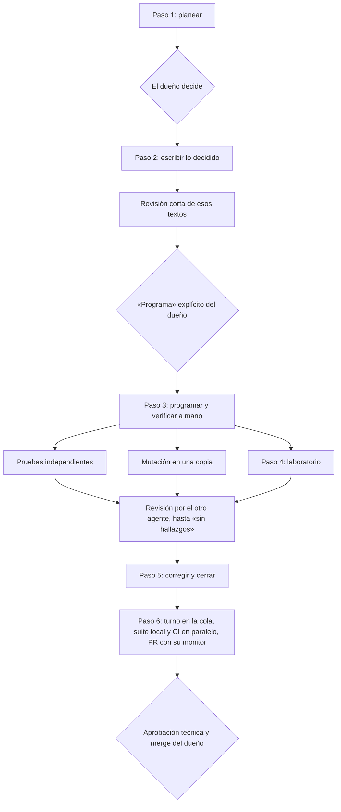
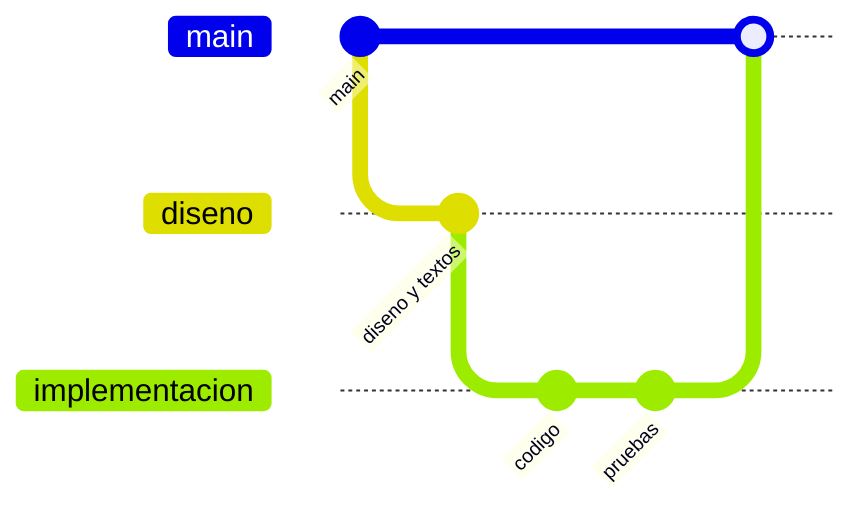

# Guía completa

Cómo funciona cada parte de la metodología y por qué está así. Para montarla en un proyecto, la [guía de adopción](adopcion.md). Para el detalle que lee el agente, las referencias de la skill (`plugins/metodologia-agentes/skills/metodologia-agentes/references/`).

## Contenido

1. [Para quién es](#1-para-quién-es)
2. [Los roles](#2-los-roles)
3. [Una sesión de principio a fin](#3-una-sesión-de-principio-a-fin)
4. [Las decisiones](#4-las-decisiones)
5. [La memoria en el repositorio](#5-la-memoria-en-el-repositorio)
6. [El ciclo de un módulo](#6-el-ciclo-de-un-módulo)
7. [Pruebas, mutación y revisiones](#7-pruebas-mutación-y-revisiones)
8. [Dos agentes en el mismo repositorio](#8-dos-agentes-en-el-mismo-repositorio)
9. [El mapa, el hub y la orquestación](#9-el-mapa-el-hub-y-la-orquestación)
10. [Repositorio, PR y CI](#10-repositorio-pr-y-ci)
11. [Contexto y uso](#11-contexto-y-uso)
12. [Qué se configura](#12-qué-se-configura)
13. [Proyectos chicos y equipos grandes](#13-proyectos-chicos-y-equipos-grandes)
14. [Los errores que evita](#14-los-errores-que-evita)
15. [Límites](#15-límites)

## 1. Para quién es

Para proyectos en los que:

- uno o dos agentes de código hacen la mayor parte del trabajo de planear, programar y revisar;
- hay una persona que responde por lo técnico y quiere decidir, no solo aprobar al final;
- el trabajo dura más de un chat: semanas, varios computadores, a veces dos agentes a la vez;
- el producto tiene que cumplir una fuente técnica (una norma, una especificación, un contrato de API, una regulación), o al menos tiene reglas de negocio que no se pueden equivocar.

Cuándo no conviene: un script de una tarde, un prototipo que se va a botar o un proyecto sin nadie que decida. Ahí el proceso pesa más de lo que protege (ver [sección 13](#13-proyectos-chicos-y-equipos-grandes)).

## 2. Los roles

| Rol | Quién | Qué hace | Qué no hace |
|---|---|---|---|
| Dueño técnico | Una persona | Decide lo técnico, incluido cómo se le presentan al usuario los resultados y los avisos; aprueba los PR técnicos; hace el merge | Escribir la línea de aprobación por otro |
| Dueño de un área | Otra persona, si la hay | Decide su área (por ejemplo, la interfaz) | Decidir lo técnico que no es de su área |
| Agente que coordina (el orquestador) | El chat principal; puede ser un modelo barato | Planea, propone decisiones, coordina a los demás y juzga en las compuertas; hace los commits | Decidir por el dueño; escribir código; revisar su propio trabajo |
| Trabajadores que piensan | Subagentes con el modelo fuerte y esfuerzo alto | Diseñan, refutan, sintetizan y verifican a mano | Ejecutar trabajo mecánico |
| Ejecutores | Subagentes, con un modelo más económico | Siguen contratos exactos: leer, programar tareas acotadas, pruebas, mutación | Decidir algo que pida criterio |
| Segundo agente | Por ejemplo Codex, en su propio worktree | Las tareas que el dueño le asigna; revisa el trabajo del primero | Tocar la carpeta, las ramas o los PR del otro |
| Hub | Un chat más, cuando hay varios chats a la vez | Lleva el tablero, junta las decisiones en una sola lista y pasa las palabras textuales del dueño | Programar, revisar, decidir, hacer commits |

Quién decide qué se escribe en el `CLAUDE.md` del proyecto. Si no está escrito, el agente pregunta.

## 3. Una sesión de principio a fin

1. **Arranque.** El agente lee `CLAUDE.md`, `AGENTS.md` siempre que se use Codex, la carpeta de memoria de `main` y de su rama, y el mapa del plan, si lo hay, para saber qué bloque le toca. Corre `git fetch --prune`, `git worktree list` y `git status`. Si es el primer chat del día en ese computador, revisa las versiones y la salud del entorno. Así sabe qué se decidió, en qué rama está cada agente y qué quedó sin commit.
2. **Trabajo.** Sigue el ciclo del módulo en el que va ([sección 6](#6-el-ciclo-de-un-módulo)). Cada respuesta del dueño se copia al registro en el momento en que llega. Cada cosa hecha se marca en el mapa en el mismo commit.
3. **Cierre.** Por límite de uso, por contexto lleno, por un umbral o porque se terminó la tarea o el bloque: memoria y mapa al día, changelog, commit y push si el dueño lo pidió o el proyecto lo acordó en `CLAUDE.md`, y un prompt para el chat siguiente, en un bloque de código, con el modelo y el esfuerzo con que se abre y dónde quedó todo. Si hay hub, el reporte de cierre con su esquema.

El cierre es lo que permite que el chat siguiente, en otro computador o con otro agente, siga sin preguntar lo que ya se sabía.

## 4. Las decisiones

### Cómo se piden

En lista numerada, cada una con sus opciones con letra y la recomendada primero y en negrilla. Un ejemplo de forma, para un proyecto cualquiera:

```
1. ¿Cómo se guardan los montos en la base de datos?
   - **a) En centavos, como enteros.** Evita errores de redondeo en sumas; obliga a convertir al mostrar.
   - b) Como decimales de precisión fija. Más legibles; depende de que todo el código use el mismo tipo.
2. ¿Qué pasa si un pago llega duplicado?
   - **a) Se rechaza el segundo con un error que dice cuál fue el primero.**
   - b) Se acepta y se marca para revisión manual.

Lo doy por decidido, dime si no: los montos se muestran con dos decimales, como dice el documento de requisitos.

Interpretación nuestra, aparte: "duplicado" es el mismo identificador de pago del proveedor, aunque el monto difiera.
```

El dueño responde "1a, 2b". Sin párrafos que releer, sin ambigüedad sobre qué escogió.

Por qué así:

- **La recomendada primero** porque el agente tiene el contexto técnico fresco y el dueño no tiene por qué reconstruirlo. Pero la decisión sigue siendo del dueño.
- **"Lo doy por decidido"** porque preguntar lo implícito gasta la atención del dueño en lo que no la necesita. Se dice igual, para que pueda corregirlo.
- **Las interpretaciones aparte** porque son el punto donde el agente llena un vacío de la fuente, y el dueño tiene que verlas una por una.
- **De una:** las decisiones se pasan apenas existen, sin esperar barridos informativos, para que el dueño no sea el cuello de botella.

### Cómo se registran

Cada respuesta va al registro textual en el momento en que llega: lo que se preguntó, las palabras del dueño tal cual y lo que no dijo. Semanas después, cuando alguien pregunte por qué algo es así, la cita resuelve la duda sin interpretaciones.

### Contra la fuente técnica

Si una decisión, incluso del dueño, va en contra de la fuente técnica, el agente no la aplica en silencio. La cita, explica qué pasaría y propone la opción que cumple. Tampoco deja el producto más estricto que la fuente sin decirlo.

## 5. La memoria en el repositorio

```
<repo>/
├── CLAUDE.md                     reglas compartidas (Claude las carga; AGENTS.md indica a Codex leerlas)
├── AGENTS.md                     para Codex, incluso solo: indica leer CLAUDE.md y la memoria
├── CHANGELOG.md                  todo cambio, por pequeño que sea
└── MEMORIA/
    ├── README.md
    ├── bitacora_equipos.md       por equipo y fecha: commits, push, PR, ramas, trabajo sin commit
    ├── entorno_equipos.md        cómo está montado cada computador
    └── registro_respuestas.md    las respuestas del dueño, textuales
```

La memoria local de un agente se queda en un computador y no la ve el otro agente. El repositorio viaja con Git. Por eso:

- las reglas que valen siempre van en `CLAUDE.md`, nunca solo en la memoria local;
- lo que pasó (commits, PR, respuestas) va en `MEMORIA/`, en la rama en la que se trabaja;
- lo que pasa después del último commit de una rama (el push, el PR, el merge) se anota en la rama siguiente;
- si un plugin de memoria choca con el repo, gana el repo.

Con varias personas o varios computadores, cada commit hecho fuera del computador principal lleva una línea `Equipo: <nombre>`, puesta por un gancho local de Git. La búsqueda de lo que se hizo desde ahí, sin meter el nombre en el comando, está en `references/plantillas.md` de la skill, "Gancho de equipo".

## 6. El ciclo de un módulo



1. **Planear.** Leer la fuente en su original, no de memoria. Pasarle al dueño lo que dice la fuente, lo que hace hoy el producto, a qué casos aplica, cuánto pesa la decisión y las decisiones en lista, con las interpretaciones aparte.
2. **Escribir lo decidido** en los documentos que son fuente de verdad, con las palabras del dueño. Una revisión corta de esos textos, por el otro agente. El commit, cuando el dueño lo pida.
3. **Programar**, solo con el «programa» explícito del dueño para esa tarea, en cualquier frente; un plan escrito no es programar. El agente verifica a mano con los números de los documentos y un caso completo por la cadena real, y lanza pruebas independientes, mutación y la página de laboratorio. Con orquestador y ejecutores ([sección 9](#9-el-mapa-el-hub-y-la-orquestación)), el chat principal no escribe el código.
4. **Laboratorio**: una página local que llama al código real, para que el dueño vea casos sin esperar a los revisores.
5. **Corregir y cerrar** lo confirmado. Si una prueba contradice una corrección, gana la decisión escrita, y la fuente técnica gana sobre todo. La revisión va en tandas hasta «sin hallazgos».
6. **Subir:** integrar `main`, esperar el turno en la cola de merges, arrancar la suite local y abrir el PR al mismo tiempo, con el monitor del PR prendido, para que la local y la CI corran juntas. Con la suite y los demás checks en verde (salvo el de la línea de aprobación), pedir la línea una sola vez.

El orden importa: planear antes evita código para una regla que iba a cambiar, y escribir lo decidido antes deja algo contra qué probar.

## 7. Pruebas, mutación y revisiones

Son tres herramientas distintas:

| Herramienta | Qué responde | Regla clave |
|---|---|---|
| Pruebas independientes | ¿El código da lo que debe? | Valores esperados a mano, desde la fuente; nunca copiados del código |
| Mutación | ¿Las pruebas detectan errores? | Siempre en una copia del commit; "detectado" es una aserción fallida, no una excepción |
| Revisiones adversariales | ¿Qué no se le ocurrió a nadie probar? | Lentes distintos y un verificador por hallazgo que intenta refutarlo |

Una prueba que copia el resultado del código solo comprueba que el código da lo que da: pasa siempre, también cuando está mal. Por eso los agentes de pruebas escriben cada uno en su propio archivo, con su propio oráculo, sin ver las pruebas de los otros.

Nadie revisa su propio trabajo: lo que hizo un agente lo revisa el otro, en un chat nuevo de solo lectura que verifica él mismo cada hallazgo, y esa opción no se le ofrece al dueño. Los validadores mecánicos, los que comprueban con comandos reales y conteos, siguen corriendo pero no cuentan como revisión. La revisión va en tandas: hallazgo, corrección, commit y una recomprobación sobre el diff exacto, hasta «sin hallazgos»; solo entonces se abre el PR. Con un solo agente en el proyecto, revisa un chat nuevo de solo lectura de ese agente y queda anotado que no es independiente.

## 8. Dos agentes en el mismo repositorio

Cada agente en su carpeta: uno en la carpeta principal, el otro en un worktree de Git. Cada tarea, de un solo agente, en su propia rama nacida de `main`:

```bash
git fetch --prune
git switch --no-track -c <rama> origin/main
git push -u origin <rama>
```

Cuando uno diseña y el otro programa, la rama del que programa nace de la del que diseñó:



Las reglas que más problemas evitan:

- **Los agentes no se hablan directo:** el dueño pasa los mensajes, que cada agente deja listos en un bloque de código. Con hub, los chats del mismo agente se hablan por el hub; los del otro agente siguen por el dueño.
- **Todo prompt para un chat nuevo dice modelo y esfuerzo**, y se le pasa al dueño apenas está listo, sin que lo pida.
- **Ninguno da por hecho lo que hizo el otro:** lo verifica en Git y en la memoria.
- **Los archivos compartidos** (changelog, memoria, mapa, documentos) se integran con merge, nunca con rebase, conservando los dos lados.
- **Modelos por función:** un orquestador barato que coordina y juzga; el modelo fuerte, con esfuerzo alto, para diseñar, refutar y verificar; uno económico para ejecutar contratos cerrados. Los ejecutores no deciden ([sección 9](#9-el-mapa-el-hub-y-la-orquestación)).

## 9. El mapa, el hub y la orquestación

Tres piezas para cuando el trabajo deja de caber en un chat: varios frentes a la vez, varios chats y workflows con muchos agentes.

### El mapa del plan

Un archivo del repositorio con el plan por bloques: qué es cada bloque, su estado, de qué depende, qué corre en paralelo y qué en serie, y lo que falta del proyecto y no está en el mapa. Cada paso es una casilla, y **cada cosa hecha se marca en el mismo commit que la hace**, con quién, la fecha y el commit o la evidencia; los pasos del dueño los marca el agente que recibe su respuesta, con sus palabras. Nada se borra: lo que deja de aplicar se tacha y se dice por qué. Un script genera el dibujo del mapa desde el archivo y una prueba de la suite comprueba que coinciden. Todo chat lo lee al empezar, para saber en qué bloque va y qué le toca.

### El hub

Cuando hay varios chats de trabajo a la vez, el dueño no puede estar al día con todos sin que se crucen decisiones. El hub es un chat más, el orquestador de orquestadores y el único contacto del dueño con los chats de trabajo: lleva el tablero (qué chat hace qué, en qué rama y en qué estado), junta en una sola lista numerada de corrido todo lo que el dueño tiene que decidir, les pasa a los chats sus respuestas con sus palabras textuales, escribe los prompts de los chats nuevos (siempre con modelo y esfuerzo) y vigila la cola de merges y que dos ramas no toquen los mismos archivos. No programa, no revisa ni hace commits. Los chats le reportan solo en los hitos, con un esquema fijo de menos de 15 líneas, sin acuses de recibo. Si hay chats de los dos agentes y el cliente del otro no puede escribirle al hub (en Codex, su revisión automática bloquea esos envíos), hay un hub espejo en ese cliente que solo crea los chats con los prompts que recibe, sin ejecutarlos; esos chats no le reportan a ningún hub: dejan su informe y el dueño pega el resultado.

### Orquestador, trabajadores que piensan y ejecutores

Con el «programa» dado, el chat principal orquesta y no hace el trabajo: coordina y juzga en las compuertas entre fases, lee resúmenes con esquema y no transcripciones, y hace los commits. Puede ser un modelo barato. Los trabajadores que piensan (diseño, refutación, verificación a mano) usan el modelo fuerte con esfuerzo alto. Los ejecutores usan un modelo económico, reciben contratos exactos, tienen dos intentos y no deciden nada. Cada fase es un workflow con un guion común: documentos; diseño con un diseñador y un refutador; ejecución con pruebas independientes y mutación; verificación a mano y validadores con comandos reales (que no cuentan como revisión); revisión por el otro agente; cierre con la suite en paralelo con el PR. Las fases se encadenan solas y se paran antes de la revisión solo por algo contra la fuente técnica, una discrepancia que las decisiones escritas no cierren o un ejecutor que no cierra en dos intentos.

### Umbrales y economía

`CLAUDE.md` fija un umbral de aviso y uno de cierre para el contexto del chat que orquesta, para el uso semanal del modelo caro y para el uso semanal total. Al acercarse, el agente lo dice; al alcanzarlo, cierra todo sin borrar nada y, según el caso, pasa un prompt para seguir en otro chat o dice qué falta y cuánto costaría, y decide el dueño. El costo de un chat es su contexto por sus turnos: por eso un chat por bloque, nada de acuses ni de reportes de pasos y verificación solo en los hitos.

## 10. Repositorio, PR y CI

- **`main` protegida:** solo por PR, con los checks obligatorios en verde y con merge, no squash.
- **Revisión técnica del dueño** para los archivos de una lista versionada. La línea de aprobación en el PR la escribe solo el dueño, con la fecha y el último commit; el agente se la pide una sola vez, con la suite y los demás checks en verde (el de la línea es el único que puede faltar) y sin commits pendientes. Esa línea es un registro y no autentica a nadie; la aprobación verificable es la revisión obligatoria de `CODEOWNERS` en la protección de `main`.
- **Todo PR lleva el monitor del PR del cliente** (Auto-fix, en Claude Code), prendido por la sesión que lo abre: avisa de fallos de CI, conflictos y comentarios, sin polling. Si el cliente no tiene monitor, se dice y la CI se revisa cuando haga falta.
- **Cola de merges:** un solo PR en revisión a la vez. El siguiente se abre cuando el anterior está unido y `main` integrada; quien está listo avisa con su HEAD y espera el turno.
- **Changelog para todo.** Un commit sin su entrada en el changelog no se hace.
- **Suite local y CI en paralelo.** Con el PR abierto, el resultado de la suite local va en la descripción del PR: editarla no vuelve a correr la suite (su workflow no escucha `edited`), un commit sí. El check de la línea de aprobación, en cambio, escucha `edited`, para reevaluarse cuando el dueño la marca.
- **Correcciones chiquitas en el PR en curso**, no en uno aparte: cada PR cuesta minutos de CI y una revisión.
- **La rutina después del merge del PR propio:** en la carpeta dueña de `main`, actualizar `main` local, borrar la rama, revisar la CI de `main`, reconstruir el entorno publicado y anotarlo. El agente del worktree no se cambia a `main`: crea su rama siguiente desde `origin/main`. Después de un merge ajeno, quien tenga una tarea en curso conserva su rama y une `origin/main` en ella.

## 11. Contexto y uso

El contexto de un chat y el uso semanal de una cuenta se acaban. La metodología los cuida así:

- el costo de un chat es su contexto por sus turnos: un chat por bloque, nada de acuses ni de reportes de pasos, un turno solo cuando hay un hito o una decisión;
- los resultados de muchos agentes se resumen con un script, no se leen completos; el orquestador no lee transcripciones;
- los reportes de los agentes son cortos (menos de 25 líneas) y con esquema; los de un chat al hub, menos de 15;
- en tareas que no son programar, el agente trabaja casi solo y pide permiso antes de lanzar más de 6 agentes;
- umbrales de aviso y de cierre, escritos en `CLAUDE.md`, para el contexto y el uso semanal ([sección 9](#9-el-mapa-el-hub-y-la-orquestación)); cerca del límite, el agente avisa y propone cómo seguir, con todo en commit si el dueño lo pidió o el proyecto lo acordó en `CLAUDE.md`.

## 12. Qué se configura

Todo esto se acuerda con el dueño y se escribe en el `CLAUDE.md` del proyecto:

| Qué | Ejemplo de valor | Por qué importa |
|---|---|---|
| La palabra que autoriza programar | "programa", explícita y por tarea | Separa planear de programar sin ambigüedad, en todos los frentes |
| Idioma y trato | Español, de tú | Los mensajes los lee una persona todos los días |
| Quién revisa el trabajo de cada agente | El trabajo de uno lo revisa el otro, en solo lectura | Nadie revisa su propio trabajo; el dueño escoge lo demás |
| Archivos que exigen revisión técnica | Una lista en `.github/` | El check del PR la lee |
| Agentes y modelos | Un orquestador barato, trabajadores que piensan con el modelo fuerte, ejecutores económicos | Costo y calidad |
| Umbrales | Contexto, uso semanal del modelo caro y uso semanal total: aviso y cierre | Evitan que un chat se quede a medias |
| Hub | Sí, cuando hay varios chats; quién abre los chats nuevos; esquema de reporte | Un solo contacto para el dueño |
| Monitor del PR (Auto-fix en Claude Code) | Siempre que el cliente lo tenga, por la sesión que abre el PR | Avisa sin polling |
| Cola de merges | Un solo PR en revisión; el turno lo avisa el hub o el dueño | Los PR no se cruzan |
| Presupuesto de CI | Minutos al mes | Define cuántos PR y cuántos push convienen |
| Atribución de herramientas en los PR | Ninguna | Preferencia del equipo |

## 13. Proyectos chicos y equipos grandes

**Proyecto chico, una persona:** la persona es el dueño. Se puede quedar con la lista de decisiones, la memoria en el repo, el changelog y el ciclo planear-programar. Lo que se puede recortar sin perder lo esencial: el segundo agente, la mutación en cada módulo, las revisiones con varios lentes, el mapa y el hub. Lo que no conviene recortar: los valores esperados a mano en las pruebas, la memoria en el repo y que quien revisa no sea el chat que hizo el trabajo.

**Equipo grande:** cada área con su dueño, escrito en `CLAUDE.md`. La lista de archivos que exigen revisión técnica se vuelve el mapa de quién aprueba qué. La bitácora por equipo pasa a ser por persona y equipo. Con varios chats a la vez, el hub y la cola de merges ([sección 9](#9-el-mapa-el-hub-y-la-orquestación)).

## 14. Los errores que evita

| Lo que pasa sin la metodología | Qué regla lo evita |
|---|---|
| El agente toma una decisión técnica en silencio | El dueño decide; las interpretaciones van aparte |
| Un chat nuevo repite una discusión ya cerrada | El registro textual en el repo |
| Las pruebas pasan aunque el código esté mal | Valores esperados a mano y mutación |
| Dos agentes editan el mismo archivo a la vez | Carpetas separadas y una tarea por agente |
| Un rebase borra el trabajo del otro agente | Merge, nunca rebase, conservando los dos lados |
| La CI se reinicia por un commit que solo anota resultados | El resultado va en la descripción del PR |
| El chat se queda sin contexto a la mitad | Cierre con memoria al día y prompt para el siguiente; umbrales de aviso y de cierre |
| El agente revisa lo que él mismo escribió y no ve sus errores | Nadie revisa su propio trabajo |
| Alguien programa antes de que el dueño lo autorice | Nadie programa sin el «programa» explícito |
| Cuatro chats a la vez y el dueño pierde el hilo | El hub: tablero, lista única de decisiones, palabras textuales |
| Dos PR se cruzan en los mismos archivos | La cola de merges |
| Algo se da por hecho y no lo estaba | El mapa del plan: cada cosa se marca en el mismo commit, con evidencia |
| Una versión distinta en un computador rompe lo que en otro funciona | La revisión diaria de versiones y de salud |
| Un chat largo gasta el uso en acuses y reportes de pasos | Un chat por bloque, turnos solo con hitos |

## 15. Límites

- La skill instruye; no obliga. Lo que de verdad hace cumplir las reglas es el `CLAUDE.md` del proyecto, la protección de `main`, los checks del PR y la disciplina del equipo.
- Depende de que el modelo siga las instrucciones. Por eso las reglas importantes también van en `CLAUDE.md`, que Claude Code carga en cada sesión y que `AGENTS.md` indica leer a Codex.
- No trae hooks, comandos ni servidores.
- Se activa por su descripción en los proyectos que la adoptaron, sin garantía; en Codex, ver [codex.md](codex.md). Si no se activa, se puede pedir explícitamente ("trabajemos con la metodología").
